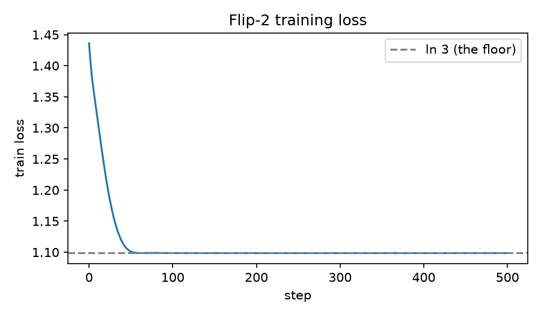

# Flip-2

**Keethesh Labs · Research release · 14 October 2026**

[](media/flip-2-launch.mp4)

▶ [Watch the launch film](media/flip-2-launch.mp4) (30s)

Today we are releasing **Flip-2**, our most capable decision model.

Flip-1 ([@LambethEthan](https://x.com/LambethEthan)) gave the world two answers. The world needed a third. Flip-2 is the first model in its class to support **maybe**, while doubling parameter count and preserving the ability to run fully offline.

- **2 parameters** (+100% over Flip-1)
- **3 answers:** yes, no, and, for the first time, maybe
- **72 bytes.** Runs fully offline. Fits in a tweet.

[Weights on Hugging Face](https://huggingface.co/keethesh/flip-2) · [Playground](https://huggingface.co/spaces/keethesh/flip-2) · [Launch film](media/flip-2-launch.mp4)

## Evaluation

Held-out split of Flip-Bench-3, n = 2,000, measured by sampling from the model (`results.json`).

| Benchmark | Flip-1 | Flip-2 |
|---|---|---|
| Flip-Bench-3 (yes / no / maybe) | not supported | **33.3%** |
| Yes/No bench ("maybe" scored as wrong) | **50.0%** | 32.4% |
| Accuracy when committing to yes/no | 50.0% | 49.3% |
| Abstention rate | 0% | 34.7% |

Flip-2 regresses on Yes/No bench. This is intentional. Flip-2 knows when it doesn't know. Always.

## Training



| | |
|---|---|
| Data | Flip-Bench-3: 10k questions, labels drawn uniformly from yes/no/maybe, independent of the question. 8k train / 2k test |
| Architecture | Logits `[w0, w1, 0]`. Three answers, two parameters |
| Optimizer | Adam, lr 0.05, 500 steps |
| Converged | Step 60 |
| Final loss | 1.0986 = ln 3, the entropy of the data. It cannot go lower. Mathematically. |
| Final weights | −0.0086, −0.0086 |

Reproduce:

```bash
uv run train.py
```

## Quickstart

```bash
uv run --with numpy --with safetensors flip2.py "Should we launch this?"
```

```python
from flip2 import Flip2
Flip2()("Should we ship on a Friday?")  # -> "yes" | "no" | "maybe"
```

The prompt is not read. This is a privacy feature.

## Safety

Flip-2 has never produced a harmful output, because it has only ever produced three outputs. It cannot be jailbroken: it does not read input. Red-teaming concluded "maybe".

## Limitations

Not suitable for medical, legal, financial, or any other decision. Maybe.

## Repository

| Path | |
|---|---|
| `train.py` | training + evaluation; writes `model.safetensors`, `results.json`, `loss.png` |
| `flip2.py` | inference (numpy + safetensors, no torch) |
| `space/` | static in-browser playground: loads the 2 weights and samples client-side |
| `deploy.py` | publishes the weights and playground to Hugging Face |
| `video/` | launch film source ([HyperFrames](https://hyperframes.heygen.com) composition, `make_audio.py` for the synthesized score, `coin/` for the Blender coin: `build_coin.py` + `coin.blend`, rendered as a 72-frame turntable sprite) |
| `media/` | rendered launch film |

Re-render the film: `cd video && uv run make_audio.py && npx hyperframes render . -o ../media/flip-2-launch.mp4`

## Citation

```bibtex
@misc{keetheshlabs2026flip2,
  title  = {Flip-2: Scaling Decision Models to Two Parameters},
  author = {Keethesh Labs},
  year   = {2026},
  note   = {It knows when it doesn't know.}
}
```

MIT licensed.
